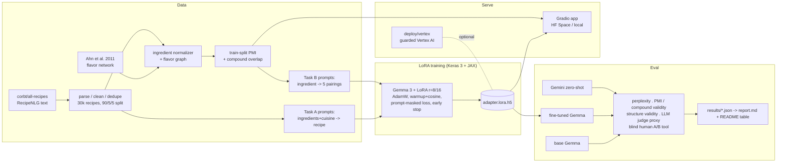

# Gemma Fine-Tuning for Recipe & Flavor-Pairing Generation

[](https://github.com/nikhil3495/Gemma-Fine-Tuning/actions/workflows/ci.yml)
[](LICENSE)
[](docs/BLOCKERS.md)
[](docs/BLOCKERS.md)
[](https://kaggle.com/kernels/welcome?src=https://github.com/nikhil3495/Gemma-Fine-Tuning/blob/main/notebooks/train_kaggle_tpu.ipynb)
[](https://colab.research.google.com/github/nikhil3495/Gemma-Fine-Tuning/blob/main/notebooks/train_colab.ipynb)

**Live demo:** not deployed yet. The Space deploy script is ready but needs an `HF_TOKEN` ([docs/BLOCKERS.md](docs/BLOCKERS.md)). Run it locally with `python app/app.py`.

LoRA fine-tuning of **Gemma 3** with **Keras 3 + JAX + keras_hub** on a 30k-recipe corpus, for two tasks:

- **Recipe generation:** *"Create a recipe using: chicken, garlic, lemon. Cuisine: Southern European"* -> title, ingredients with quantities, numbered steps, flavor notes.
- **Flavor pairing:** *"Suggest 5 ingredients that pair well with basil"* -> ranked partners with reasons, grounded in corpus co-occurrence (PMI) and the Ahn et al. (2011) flavor-compound network.

The benchmark compares **LoRA fine-tuned Gemma vs base Gemma vs zero-shot Gemini** on perplexity, pairing validity (PMI and shared flavor compounds), structure validity, and preference: an LLM-judge proxy plus a blind human A/B tool. Every number below is generated from `results/*.json` by a script in this repo.

_Demo screenshot: added after the first deploy (the app runs locally with `python app/app.py`)._

## Results

<!-- RESULTS:START -->
**Status: benchmark not yet run.** The real CPU smoke fine-tune (Gemma 3 270M + LoRA r=8, 1,826 train / 56 val examples) started, but the host stopped it at **step 50 of 400** because system memory ran critically low. No adapter was saved, so there are no generation-based metrics yet. What did run (from [`results/train_smoke_partial.json`](results/train_smoke_partial.json) and [`results/train_smoke_log.csv`](results/train_smoke_log.csv)):

| Measurement (smoke, partial) | Value |
|---|---|
| Base Gemma 3 270M val perplexity (exact, response tokens, 56 held-out val examples) | 31.13 |
| Val loss after 50 LoRA steps (Keras batch-mean NLL on response tokens) | 2.098 |

Complete it with `python -m recipe_gemma.train --config configs/train_smoke.yaml && make eval` (see [docs/BLOCKERS.md](docs/BLOCKERS.md)). This block is then regenerated from `results/*.json`.
<!-- RESULTS:END -->

Full report with plots: [results/report.md](results/report.md). Metric definitions and known biases: [docs/EVAL_PROTOCOL.md](docs/EVAL_PROTOCOL.md).

## Architecture



## Quickstart

```bash
git clone https://github.com/nikhil3495/Gemma-Fine-Tuning && cd Gemma-Fine-Tuning
python3.12 -m venv .venv && source .venv/bin/activate
make setup                  # pip install -e ".[train,eval,app,dev]" + tensorflow-cpu (preprocessing only)
make data                   # downloads 1 parquet shard + flavor data, builds splits/prompts (~1 min)
make train CONFIG=smoke     # REAL Gemma 3 270M LoRA run on CPU (no credentials needed)
make eval                   # generations, metrics, judge (if GEMINI_API_KEY), report + README table
make app                    # local Gradio demo
make test lint
```

Windows (no `make`): run the module commands, e.g. `python -m recipe_gemma.train --config configs/train_smoke.yaml`.
Full run: `notebooks/train_kaggle_tpu.ipynb` (Gemma 3 1B, LoRA r=16, seq 512) or `make train CONFIG=full` on a GPU.

## Repository map

| Path | What |
|---|---|
| `src/recipe_gemma/data/` | parsing, cleaning, dedupe, splits, prompt templates, output parsers |
| `src/recipe_gemma/flavor/` | ingredient normalizer, flavor graph, PMI stats, cuisine tagger, pairing scorer |
| `src/recipe_gemma/train/` | `CausalLM` wrapper (keras_hub Gemma + tiny random model for CI), LoRA trainer |
| `src/recipe_gemma/eval/` | metrics, bootstrap CIs, Gemini baseline, pairwise judge, report generator |
| `app/` | Gradio demo (HF Space entry point) |
| `annotation/` | blind A/B human-preference tool + instructions |
| `deploy/vertex/` | guarded Vertex AI training/endpoint scripts (auto-teardown) |
| `notebooks/` | Kaggle TPU / Colab full-run notebooks, results analysis |
| `results/` | committed metrics, generations, logs, plots |
| `docs/` | DECISIONS, ENVIRONMENT, DATA_CARD, EVAL_PROTOCOL, BLOCKERS |

## Engineering notes

- **Runs on Windows CPU.** keras_hub's tf.data tokenization needs `tensorflow-text` (no Windows wheels), so tokenization happens eagerly in Python, training runs on NumPy batches via a seeded `PyDataset`, and keras_hub's `PipelineModel.fit` is bypassed for the plain Keras trainer. The prompt is masked out of the loss.
- **CI without secrets.** A tiny random pure-Keras causal LM implements the same `CausalLM` interface, so CI exercises training, LoRA save/load, scoring, generation and the whole eval runner offline.
- **Reproducibility.** Fixed seeds, hash-based splits, cached generations, and every result file records git SHA, config hash, model preset and timestamp.
- All choices are logged in [docs/DECISIONS.md](docs/DECISIONS.md).

## Limitations (honest)

- The smoke run was **interrupted at step 50/400** (host memory pressure); the benchmark tables are pending its completion. Once complete, the numbers come from a **smoke run**: Gemma 3 **270M**, a few hundred LoRA steps on a laptop CPU, evaluated on 25 + 25 held-out prompts. CIs are wide. The full 1B run is configured but not yet run (needs a TPU/GPU).
- The Gemini baseline and LLM judge need an API key that was unavailable at build time; those cells say so instead of showing numbers.
- Human preference is **pending annotation**. LLM-judge numbers are a proxy and are labelled as such.
- Task-B targets and the PMI metric share the same training-corpus statistics (see EVAL_PROTOCOL "threats to validity").
- Data is RecipeNLG-derived (non-commercial terms) and US-centric; generated recipes are not food-safety advice.

## License

Code: Apache-2.0. Model weights and the adapter: [Gemma Terms of Use](https://ai.google.dev/gemma/terms). Flavor data: Ahn et al. 2011, CC BY-NC-SA 3.0. Recipe data: RecipeNLG terms (non-commercial). See [docs/DATA_CARD.md](docs/DATA_CARD.md) and [MODEL_CARD.md](MODEL_CARD.md).
