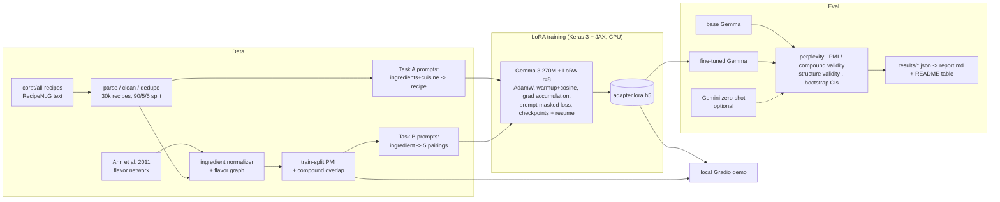

# Gemma Fine-Tuning for Recipe & Flavor-Pairing Generation

[](https://github.com/nikhil3495/Gemma-Fine-Tuning/actions/workflows/ci.yml)
[](LICENSE)

LoRA fine-tuning of **Gemma 3 270M** with **Keras 3 + JAX + keras_hub** on a 30k-recipe corpus, trained entirely **offline on a laptop CPU** (no GPU, no cloud). The test-set benchmark has not been run yet. It covers two tasks:

- **Recipe generation:** *"Create a recipe using: chicken, garlic, lemon. Cuisine: Southern European"* -> title, ingredients with quantities, numbered steps, flavor notes.
- **Flavor pairing:** *"Suggest 5 ingredients that pair well with basil"* -> ranked partners with reasons, grounded in corpus co-occurrence (PMI) and the Ahn et al. (2011) flavor-compound network.

The training run is complete: held-out validation perplexity went from base to LoRA as shown in the results block below. The benchmark harness, which compares **LoRA fine-tuned Gemma vs base Gemma** on held-out test prompts (perplexity, pairing validity via PMI and shared flavor compounds, and structure validity, all with bootstrap CIs), is implemented and tested but **has not been run yet** (see "Results"). A zero-shot Gemini baseline and an LLM-judge preference proxy are implemented as **optional** features (they need a `GEMINI_API_KEY`). A blind A/B tool is included for human preference. Every number in the results block is written by `python -m recipe_gemma.eval.report` from files in `results/`.

## Results

<!-- RESULTS:START -->
_SMOKE run (CPU, Gemma 3 270M, small data): pipeline proof, not a final benchmark. Auto-generated from `results/*.json` by `make eval`._

- Run: **smoke** (git `5c3df23-dirty`, config hash `f8e68ee8279a`, 2026-11-21T17:25:34+00:00)
- Model: `hf://unsloth/gemma-3-270m-it`: 268,632,704 params, LoRA rank 8 -> 534,528 trainable (0.20%)
- Data: 1,396 train / 48 val examples ({'recipe': 996, 'pairing': 400}); dropped for length: {'train': 604, 'val': 36}
- Steps: 400 optimizer steps (best val loss at 400), micro-batch 1 x grad-accum 4 = effective batch 4; resumed once from the step-200 checkpoint
- Compute: CPU only (Windows-11-10.0.26300-SP0); 141 min wall-clock (21.2 s/step incl. host stalls); peak RSS 3.38 GB
- Val loss: best 1.4345; val perplexity **30.80 (base) -> 4.21 (LoRA)** on 48 val examples

**Benchmark (base vs fine-tuned generations, perplexity, pairing/structure validity) not yet run.** Run one model at a time: `python -m recipe_gemma.eval --config configs/eval.yaml --models base`, then `--models finetuned`, then `--stages metrics,judge`, then this report.
<!-- RESULTS:END -->

Full report with plots: [results/report.md](results/report.md). Metric definitions and known biases: [docs/EVAL_PROTOCOL.md](docs/EVAL_PROTOCOL.md).

## Run locally

Steps 1-2 were run on Windows 11 (Python 3.12, CPU only, 16 GB RAM); step 3 has not been run yet. Training peaked at 3.38 GB RSS (`results/train_smoke.json`). Time and RAM figures in the comments below are estimates except where a results file is cited.

```bash
git clone https://github.com/nikhil3495/Gemma-Fine-Tuning && cd Gemma-Fine-Tuning
python3.12 -m venv .venv && source .venv/bin/activate        # Windows: .venv\Scripts\activate
pip install -e ".[train,eval,app,dev]" tensorflow-cpu safetensors sentencepiece   # = make setup

# 1) data: one parquet shard of the recipe corpus + flavor network -> splits and prompts (~1 min)
python -m recipe_gemma.data.build --config configs/data.yaml                        # = make data

# 2) train: LoRA on Gemma 3 270M, CPU; ~6.6 s/optimizer step (~45 min compute; the committed run took 141 min incl. host stalls); checkpoints every 50 steps
python -m recipe_gemma.train --config configs/train_smoke.yaml --dry-run           # 5-step memory check
python -m recipe_gemma.train --config configs/train_smoke.yaml                     # = make train
python -m recipe_gemma.train --config configs/train_smoke.yaml --resume            # after an interruption

# 3) evaluate (needs the adapter from step 2; checkpoints/ is not committed): base vs fine-tuned, one model at a time
python -m recipe_gemma.eval --config configs/eval.yaml --models base
python -m recipe_gemma.eval --config configs/eval.yaml --models finetuned
python -m recipe_gemma.eval --config configs/eval.yaml --stages metrics,judge
python -m recipe_gemma.eval.report --config configs/eval.yaml
python scripts/make_model_card.py --config configs/train_smoke.yaml --eval-config configs/eval.yaml

# 4) demo: local Gradio app at http://127.0.0.1:7860
python app/app.py                      # pairing lookup + cached benchmark generations (after step 3)
LIVE_MODEL=1 python app/app.py         # live generation; needs the adapter from step 2

python -m pytest && ruff check . && ruff format --check .   # = make test lint
```

The Gemma weights are downloaded by keras_hub from `hf://unsloth/gemma-3-270m-it`, an ungated copy of `google/gemma-3-270m-it` under the Gemma Terms of Use, so no account or token is needed.

## Architecture



## Repository map

| Path | What |
|---|---|
| `src/recipe_gemma/data/` | parsing, cleaning, dedupe, splits, prompt templates, output parsers |
| `src/recipe_gemma/flavor/` | ingredient normalizer, flavor graph, PMI stats, cuisine tagger, pairing scorer |
| `src/recipe_gemma/train/` | `CausalLM` wrapper (keras_hub Gemma + tiny random model for CI), resumable LoRA trainer |
| `src/recipe_gemma/eval/` | metrics, bootstrap CIs, optional Gemini baseline and pairwise judge, report generator |
| `app/` | local Gradio demo |
| `annotation/` | blind A/B human-preference tool + instructions |
| `results/` | data stats, training results and logs, loss curve, report (benchmark metrics and generations after step 3) |
| `docs/` | DECISIONS, ENVIRONMENT, DATA_CARD, EVAL_PROTOCOL, FUTURE_WORK |

## Engineering notes

- **Runs on a Windows CPU laptop.** keras_hub's tf.data tokenization needs `tensorflow-text` (no Windows wheels), so tokenization runs eagerly in Python, training runs on NumPy micro-batches via a seeded `PyDataset`, and keras_hub's `PipelineModel.fit` is bypassed for the plain Keras trainer. The prompt is masked out of the loss.
- **Memory-safe.** Micro-batch 1 with gradient accumulation 4, seq 256, the XLA platform allocator without preallocation, and caches freed between phases. Peak RSS 3.24 GB in the 5-step dry run (`results/memory_dryruns.log`) and 3.38 GB in the full run (`results/train_smoke.json`).
- **Interruption-proof.** The LoRA adapter, optimizer state and run state are saved every 50 steps; `--resume` restores them and the data position. The committed run was stopped by host memory pressure at about step 230 and resumed from the step-200 checkpoint. That resume predates optimizer-state saving, so Adam moments restarted from zero.
- **CI without secrets or downloads.** A tiny random pure-Keras causal LM implements the same `CausalLM` interface, so CI exercises training, accumulation, checkpoint/resume, LoRA save/load, scoring, generation and the whole eval runner.
- **Reproducibility.** Fixed seeds, hash-based splits, cached generations. Every result file records git SHA, config hash, model preset and timestamp. Decisions are logged in [docs/DECISIONS.md](docs/DECISIONS.md).

## Limitations

- **Small and short:** Gemma 3 **270M**, 400 LoRA steps (effective batch 4) on a laptop CPU. The validation-perplexity gain shows that the model learned the corpus's format and distribution, not that it cooks well. Treat it as a demonstration of the method, not a state-of-the-art recipe model.
- **Benchmark pending:** the base-vs-fine-tuned test-set evaluation was stopped by host memory pressure before producing results; the commands are in [docs/FUTURE_WORK.md](docs/FUTURE_WORK.md). Until it runs, the recipe tab of the local demo has no cached generations (use `LIVE_MODEL=1` with the adapter from step 2).
- Gemini baseline and LLM-judge preference are optional and **not run** unless `GEMINI_API_KEY` is set; human preference is **pending annotation** (see [docs/FUTURE_WORK.md](docs/FUTURE_WORK.md)). LLM-judge numbers would be a proxy, never "human preference".
- Task-B targets and the PMI metric share the same training-corpus statistics (see EVAL_PROTOCOL, "threats to validity").
- Data is RecipeNLG-derived (non-commercial terms) and US-centric. Generated recipes are not food-safety advice.

## Optional: scaling up / deployment (not used in this project)

The repo also contains tooling that was **not run** for the results above: `configs/train_full.yaml` (Gemma 3 1B, needs a GPU/TPU) with `notebooks/train_kaggle_tpu.ipynb` / `train_colab.ipynb`; `scripts/push_adapter.py` and `scripts/deploy_space.py` (Hugging Face Hub / Space, need `HF_TOKEN`); and `deploy/vertex/` (guarded Vertex AI scripts that refuse to run without `ALLOW_GCP_SPEND=1`). The notebooks' Colab/Kaggle badges and the annotation tool's `--share` flag belong to this unused tooling.

## License

Code: Apache-2.0. Model weights and the adapter: [Gemma Terms of Use](https://ai.google.dev/gemma/terms). Flavor data: Ahn et al. 2011, CC BY-NC-SA 3.0. Recipe data: RecipeNLG terms (non-commercial). See [docs/DATA_CARD.md](docs/DATA_CARD.md) and [MODEL_CARD.md](MODEL_CARD.md).
