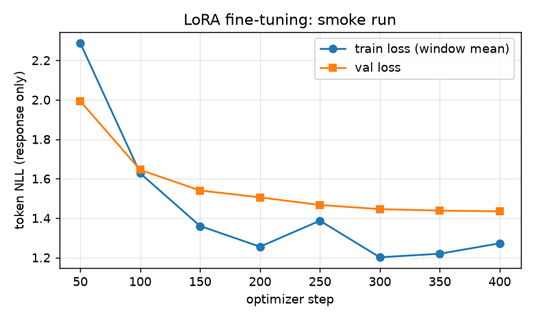

# Benchmark report: SMOKE run (CPU, Gemma 3 270M, small data): pipeline proof, not a final benchmark

_Auto-generated by `python -m recipe_gemma.eval.report`; do not edit by hand._

## Training

- Run: **smoke** (git `5c3df23-dirty`, config hash `f8e68ee8279a`, 2026-11-21T17:25:34+00:00)
- Model: `hf://unsloth/gemma-3-270m-it`: 268,632,704 params, LoRA rank 8 -> 534,528 trainable (0.20%)
- Data: 1,396 train / 48 val examples ({'recipe': 996, 'pairing': 400}); dropped for length: {'train': 604, 'val': 36}
- Steps: 400 optimizer steps (best val loss at 400), micro-batch 1 x grad-accum 4 = effective batch 4; resumed once from the step-200 checkpoint
- Compute: CPU only (Windows-11-10.0.26300-SP0); 141 min wall-clock (21.2 s/step incl. host stalls); peak RSS 3.38 GB
- Val loss: best 1.4345; val perplexity **30.80 (base) -> 4.21 (LoRA)** on 48 val examples

## Results

**Benchmark (base vs fine-tuned generations, perplexity, pairing/structure validity) not yet run.** Run one model at a time: `python -m recipe_gemma.eval --config configs/eval.yaml --models base`, then `--models finetuned`, then `--stages metrics,judge`, then this report.

Metric definitions: [docs/EVAL_PROTOCOL.md](../docs/EVAL_PROTOCOL.md).
